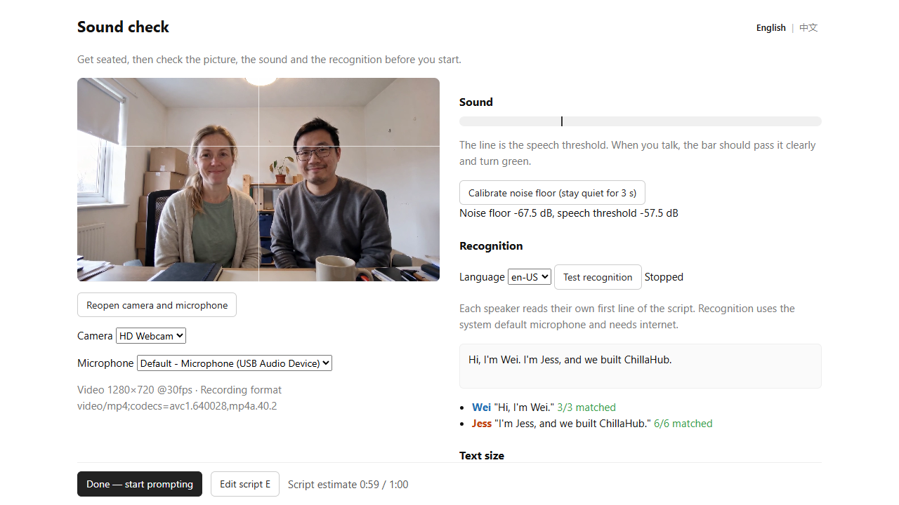
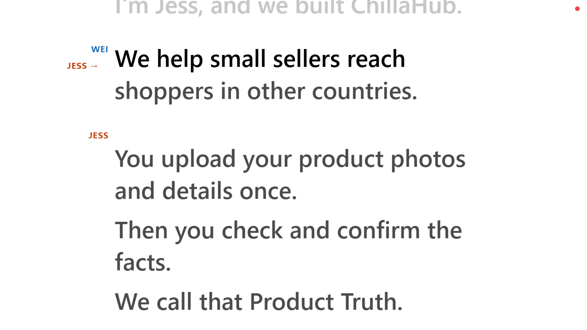
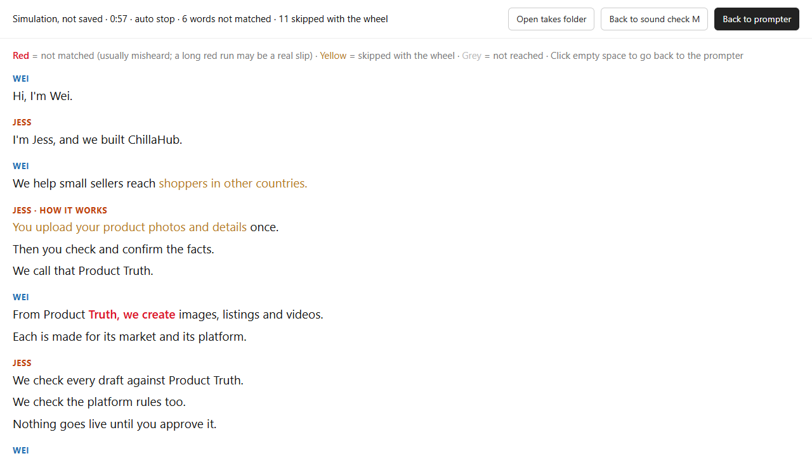
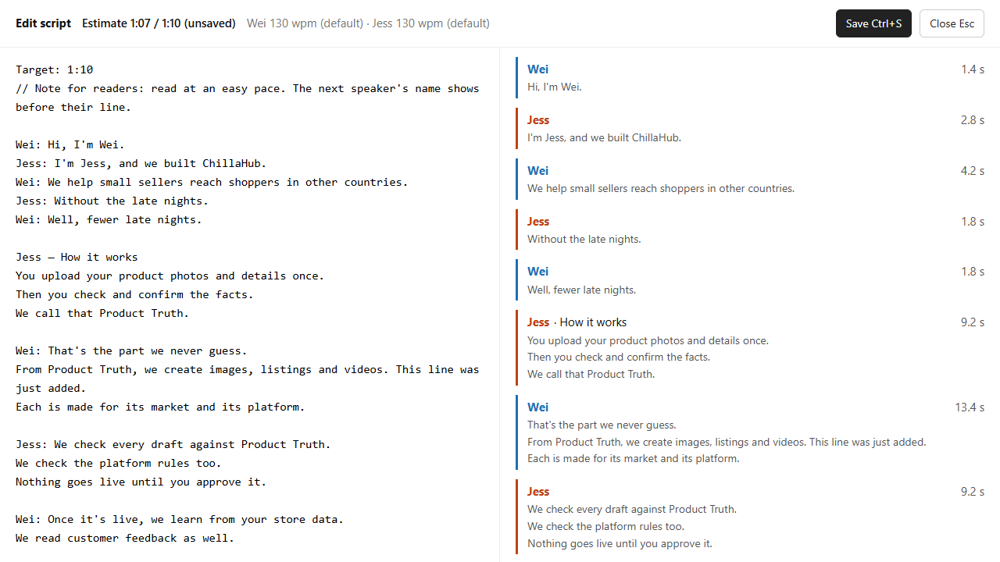

# voice-teleprompter

**English** · [中文](README.zh-CN.md)

A teleprompter that runs in Chrome. It listens while you read, scrolls the script with your voice, shows the next speaker's name just before their turn, and records the webcam. It works for one speaker or several taking turns.

<!-- media:hero -->
https://github.com/user-attachments/assets/b38d3c8b-7656-4c5c-8879-485754497707

Vertical 9:16 version for phones: [English UI](https://github.com/hengjingzhu/voice-teleprompter/releases/download/v1.0.0/voice-teleprompter-demo-vertical-en.mp4) · [Chinese UI](https://github.com/hengjingzhu/voice-teleprompter/releases/download/v1.0.0/voice-teleprompter-demo-vertical-zh.mp4)

<sub>Demo: the people and voices are AI-generated, the names are fictional, and speech recognition is simulated so the demo can be regenerated. With a real microphone it works the same way.</sub>

## Made for founder videos

Many accelerator and incubator applications ask for a short founder video, usually 1 to 3 minutes, often with every co-founder on camera. It has to fit the limit and sound natural, and it usually takes many attempts. This app was built for that.

| You need to | How it helps |
| --- | --- |
| Stay under 60, 90 or 120 seconds | Put `Target: 1:30` on the first line of the script. The page shows the estimated length next to the limit and turns red when the script is too long. The estimate learns each speaker's reading speed from your takes. |
| Look at the camera, not at notes | The text follows your voice, so nobody has to scroll. The line you read is near the top of the screen, close to a laptop's webcam. |
| Take turns with co-founders | Write `Name: text` for each speaker. Before each turn, the next speaker's name appears with an arrow, so hand-offs need less rehearsal. One webcam records everyone. |
| Record many takes quickly | Click to start. Hold the right mouse button for 1 second to discard and start again at once; hold the left one for 1 second to stop and save. Every take is kept as a video file in `takes/`. |
| Check that no point was skipped | After each take, the review page marks the words that were not heard in red. |
| Hand in a file under the limit | Ask your agent: "Which take is best? Cut it to 1:30." It cuts without re-encoding and checks that the last word is not cut off. |
| Keep the pitch private | Scripts and recordings stay on your computer. Only the microphone audio goes to Google, for speech recognition. |

### Programs that ask for a founder video

Checked on 2026-11-09 against each program's own page. Rules change from intake to intake, so check the official page before you record.

| Region | Program | Video | Length | Official page |
| --- | --- | --- | --- | --- |
| US | Y Combinator | Asked; all founders, only the founders talking | 1 min | [ycombinator.com/video](https://www.ycombinator.com/video) |
| US | PearX (Pear VC) | Required; unlisted YouTube link | 1 min | [pear.vc/pearx-application](https://pear.vc/pearx-application/) |
| US | Techstars | Team video, optional but "highly recommended" | not stated | [Techstars help](https://help.techstars.com/support/solutions/articles/4000207082) |
| US | Alchemist Accelerator | Optional; team intro and pitch | 3 min or less | [alchemist.vc/apply](https://www.alchemist.vc/apply) |
| US | Z Fellows | Optional | 1 min | [zfellows.com](https://zfellows.com) |
| US | a16z speedrun | Only if invited after the first review | not stated | [speedrun FAQ](https://speedrun.a16z.com/faq) |
| Australia | Startmate Accelerator | Required | about 90 s | [startmate.com/accelerator](https://www.startmate.com/accelerator) |
| Australia | Sydney Genesis (University of Sydney) | Required | up to 2 min | [Sydney Genesis](https://www.sydney.edu.au/business/study/student-experience/sydney-genesis.html) |
| Australia | Melbourne Accelerator Program | Required (pitch video) | not stated | [themap.co/accelerator](https://www.themap.co/accelerator) |
| Australia | UQ ilab Accelerator | Required (team intro) | not stated | [UQ Ventures](https://ventures.uq.edu.au/programs/ilab-accelerator) |
| Australia | LaunchVic 30X30 (scale-ups) | Required | up to 3 min | [Cohort 5 guidelines (PDF)](https://assets.launchvic.org/app/uploads/2025/12/09142835/30X30-Program-Guidelines-Cohort-5-.pdf) |
| Singapore | Big Idea Ventures Singapore Accelerator | Required (replaces the written team section) | not stated | [bigideaventures.com](https://bigideaventures.com/singapore-accelerator/) |
| Singapore | Surge (Peak XV) | Optional: a deck, or a Loom product demo + pitch video | not stated | [surge.peakxv.com/apply](https://surge.peakxv.com/apply) |
| Singapore | SLINGSHOT (startup competition) | Required for the top 250 | 2 min | [Selection process](https://slingshot.agorize.com/en/challenges/2026-edition/pages/selection-process?lang=en) |
| Singapore | NTU Chua Thian Poh Pinnacle Prize (competition) | Required | up to 90 s | [NTU](https://www.ntu.edu.sg/ntupreneur/news-events/chua-thian-poh-pinnacle-prize/submission-and-evaluation-criteria) |

Antler, Founder Institute and 500 Global do not ask for a founder video on their official application pages.

To record one of these: put the program's limit on the first line of the script (`Target: 1:00` for a one-minute video), record a few takes, and keep the best one under the limit.

It works the same for other scripted videos to camera, such as product intros or investor updates.

## Use it with Claude Code or Codex

Most people hand this repo to a coding agent. Install one of them first ([Claude Code](https://code.claude.com/docs/en/quickstart) or [Codex](https://learn.chatgpt.com/docs/codex/cli)), start it in a new empty folder, and paste:

```text
Clone https://github.com/hengjingzhu/voice-teleprompter into this empty folder
(git clone https://github.com/hengjingzhu/voice-teleprompter .), read its AGENTS.md and follow
its install-and-start skill. Ask me before installing anything. Start the teleprompter, open it
in Chrome, then tell me what to do on the sound check page.
```

The repo tells the agent how to work with it: [`AGENTS.md`](AGENTS.md) for the rules, and four skills in [`.claude/skills/`](.claude/skills) (Claude Code) and [`.agents/skills/`](.agents/skills) (Codex). After the first start you can ask things like:

| You say | The agent |
| --- | --- |
| "Load this script: …" | Puts it in `script.md` in the right format without changing your words, lists suspected typos, tells you how long it will take to read. |
| "Which take is best? Cut it to 1:30." | Lists the takes, cuts the one you choose, and checks that the last word is not cut off. |
| "It keeps getting stuck on our brand name." | Finds what the recognizer heard instead and adds it to `aliases.json`. |

Start those later sessions in the `voice-teleprompter` folder, so the agent loads `AGENTS.md` and the skills.

## Install it yourself

You need [Node.js](https://nodejs.org) 22 or newer, Google Chrome on a desktop computer, and an internet connection (for speech recognition). [ffmpeg](https://ffmpeg.org) is optional (see [Files](#files)).

```sh
git clone https://github.com/hengjingzhu/voice-teleprompter
cd voice-teleprompter
npm start
```

Then open <http://localhost:5178> in Chrome and allow the camera and microphone. There is nothing to install with npm. To use another port: `PORT=5200 npm start` (Windows PowerShell: `$env:PORT=5200; npm start`).

On the first start, `script.md` is created from [`examples/demo-two-speakers.md`](examples/demo-two-speakers.md). Replace it with your own script, or press <kbd>E</kbd> on the page to edit it.

## Recording a take

### 1. Sound check



<!-- media:setup -->
https://github.com/user-attachments/assets/d8f2b462-3b7f-491f-a41e-097e0b874f62

- <b>Open camera and microphone</b>, then pick them in the lists if you have more than one. The lines on the preview help you frame two people.
- <b>Calibrate noise floor (stay quiet for 3 s)</b>. When you talk, the level bar should pass the line clearly and turn green.
- <b>Test recognition</b>: each speaker reads their own first line of the script. A speaker's check turns green when at least 80% of the words of that line were recognised. A script without speaker names has no per-speaker check; read the first line and watch the heard text.
- Set the <b>Text size</b>, choose the recognition language (en-US, en-AU or en-GB), then <b>Done — start prompting</b>.

The interface language switch (English | 中文) is at the top right of this page.

### 2. Record



<!-- media:follow -->
https://github.com/user-attachments/assets/db6f5d01-712b-4d2d-8b23-3fca04a03e2d

- Click on empty space (or press <kbd>Space</kbd>) to start. A 3-2-1 countdown runs, the page goes full screen, and recording starts at the end of the countdown.
- Read at the line near the top of the screen. The text moves with your voice. During the last paragraph before someone else's turn, their name appears on the left with an arrow, for example `JESS →`.
- If someone is talking but recognition has not matched a new word for 0.7 s, the text keeps moving at that speaker's usual speed for up to 3 s and at most 15 words ahead, then waits.
- If the text gets lost, scroll with the wheel or the arrow keys, one phrase at a time.

### 3. Stop, or start again

<!-- media:controls -->
https://github.com/user-attachments/assets/35d839bb-97cd-43b9-bd56-85141ac019b0

- **Stop and save:** hold the left mouse button for 1 second (or press <kbd>Space</kbd>). The pointer is hidden while recording; a small ring in the top right corner fills while you hold.
- **Discard and start again:** hold the right mouse button for 1 second (or press <kbd>X</kbd>). The take is kept with `-x` in its name and a new countdown starts. In full screen, Chrome uses <kbd>Esc</kbd> to leave full screen, so use <kbd>X</kbd> there.
- **Automatic stop**, never in the first 10 seconds:
  - 2 seconds after the words of a short last block are heard (its own block, like `Both: Thanks for watching!`, with up to 3 words that matter), once the text has reached the block before it. Scripts without speaker names have only one block, so only the next two rules apply;
  - 2 seconds after the text reaches the last word;
  - or when the text is within 3 words of the end and, for 3.5 seconds, nobody is heard and no new word is matched.

### 4. Review



After each take you stop (a discarded take goes straight to a new countdown), the review page shows the file name, length, how the take ended, and the script in colour: <b>Red</b> words were not matched (usually misheard, not misread; a long red run may be a real slip), <b>Yellow</b> ones were skipped with the wheel, <b>Grey</b> ones were not reached. Buttons: <b>Open takes folder</b>, <b>Back to sound check</b>, <b>Back to prompter</b>. Clicking empty space also goes back to the prompter.

## Controls

<!-- shortcuts:start -->

| Mouse | When | Action |
| --- | --- | --- |
| Click on empty space | Before a take | Start a take (3 s countdown) |
| Click on empty space | Review | Back to the prompter |
| Wheel | Before a take, Recording | One phrase back or forward |
| Hold the left button 1 s | Recording | Stop and save the take |
| Hold the right button 1 s | Recording | Discard the take and restart the countdown |
| Right click | Countdown | Cancel the countdown |

| Key | When | Action |
| --- | --- | --- |
| <kbd>Space</kbd> | Before a take, Review | Start a take (3 s countdown) |
| <kbd>Space</kbd> | Recording | Stop and save the take |
| <kbd>X</kbd> / <kbd>Esc</kbd> | Recording | Discard the take and restart the countdown |
| <kbd>X</kbd> / <kbd>Esc</kbd> | Countdown | Cancel the countdown |
| <kbd>→</kbd> / <kbd>↓</kbd> / <kbd>Page Down</kbd> | Before a take, Recording | Next phrase |
| <kbd>←</kbd> / <kbd>↑</kbd> / <kbd>Page Up</kbd> | Before a take, Recording | Previous phrase |
| <kbd>E</kbd> | Before a take, Review, Sound check | Open the script editor |
| <kbd>M</kbd> | Before a take, Review | Open the sound check |
| <kbd>+</kbd> / <kbd>=</kbd> | Any time, except in the editor | Bigger text |
| <kbd>-</kbd> / <kbd>_</kbd> | Any time, except in the editor | Smaller text |
| <kbd>F</kbd> | Any time, except in the editor | Full screen on / off |
| <kbd>Ctrl+S</kbd> | Editor | Save the script |
| <kbd>Esc</kbd> | Editor | Close the editor |

<!-- shortcuts:end -->

## Writing a script

Your script is `script.md`, a plain text file. A short example:

```text
Target: 1:00
// Lines starting with // are notes for you. They are not shown or read.

Wei: Hi, I'm Wei.
Jess: I'm Jess, and we built ChillaHub.
Wei: We help small sellers reach shoppers in other countries.

Jess — How it works
You upload your product photos and details once.

Both: Thanks for watching!
```

- `Name: text` starts a speaker's block when the name is used as a speaker at least twice, or at least once as `Name:` alone or `Name — Title`. Otherwise the whole line is text (so `Upload: …` stays text). For a speaker with only one line, write `Name:` alone and put the text on the next line.
- `Name — Title` starts a block with a title (a space, then a dash: `-`, `–` or `—`). The title is shown but never read, and it is hidden while recording.
- `Both:`, `All:` or `Together:` is read together.
- Each line is a paragraph. A number at the start of a line, like `1.`, is shown and may be read or skipped.
- `Target: 1:30` on the first line sets the time limit. The estimate on the page turns red when the script is longer. Without it, no limit is shown.
- Scripts must be in English.

All the rules, with an example for each: [`examples/format-reference.md`](examples/format-reference.md) and [`docs/script-format.md`](docs/script-format.md). More examples: [one speaker](examples/solo.md), [three speakers](examples/three-speakers.md).

### Edit on the page



<!-- media:editor -->
https://github.com/user-attachments/assets/2dc0362a-7b42-4b15-b8a7-5e9cf24e1224

Press <kbd>E</kbd> for the editor. The right side shows how the script will be split into speakers and blocks, with the seconds for each block and the estimate at the top. <b>Save</b> writes `script.md` and keeps the old version in `backups/`. If you edit `script.md` in another program, the page reloads it by itself (after the take, if one is being recorded).

The estimate is 1.5 s + each block's words at its speaker's speed + 1 s per `Both:` block + 2 s. Speeds are measured from your takes, discarded ones included (the median of each speaker's last 5 takes, kept in `stats.json`). Until a speaker has been measured, and always for scripts without speaker names, 130 words per minute is used.

## Files

| Path | What it is |
| --- | --- |
| `script.md` | Your script. Not in git. |
| `takes/take-NN-YYYYMMDD-HHMMSS.mp4` | A recording. Next to it, a `.json` with the recognition log, timings and the script used (not for `-recovered` takes). |
| `takes/…-x` | A discarded take. |
| `takes/…-partial` | The upload to the local server broke off. The complete copy was saved to your Downloads folder. |
| `takes/…-recovered` | A take that was cut off (the page, browser, server or computer stopped). At its next start the server rescues the unfinished file if nothing has written to it in the last 60 s; a newer one is left until a later start. |
| `backups/` | Earlier versions of `script.md`, one per save. |
| `stats.json` | Each speaker's measured reading speed. |
| `aliases.json` | Words the recognizer keeps mishearing, e.g. `"chillahub": ["chiller hub"]`. Reload the page after editing it. |

Chrome usually records MP4 (H.264). With ffmpeg installed, the server turns each recording into a standard MP4 without re-encoding the video; a WebM recording is converted to H.264 and the original is kept as `.raw.webm`. Without ffmpeg, the browser's file is kept as it is (`.mp4` or `.webm`).

## Example output

<!-- media:opening -->
https://github.com/user-attachments/assets/f55872fb-30c1-4156-b495-c11f7a74cb64

<sub>Illustration of what a take looks like. This clip was generated with AI for the demo; it was not recorded by the app.</sub>

## Privacy and limitations

- **Speech recognition is Chrome's.** It sends the microphone audio to Google and needs internet. Everything else stays on your computer: the server only listens on `127.0.0.1`, scripts and recordings are saved in this folder, and nothing is sent anywhere else.
- **Strong accents slow it down.** Where recognition turns into nonsense, the text slows down or stops. Help it along with the wheel, and add names it keeps mishearing to `aliases.json`.
- **English scripts only.** Text in other languages is shown but cannot be followed.
- **It does not know who is speaking.** Recognition uses the system's default microphone (the list on the sound check page picks the recording microphone), and the order of the script decides whose turn it is.
- **Desktop Chrome only.** Other browsers have no speech recognition, or a different one.

## What was tested

The whole app (camera, microphone, recognition and recording) was tested on Windows 11 with Chrome. The unit tests run on Windows, macOS and Linux with Node 22 on every push (see [Actions](../../actions)). macOS and Linux should work but were not tested by hand.

## Development

```sh
npm test                 # unit tests, including simulated reading of every example and your own script.md
npm run docs:tables      # rewrite the Controls tables in both READMEs from public/shortcuts.js
npm run estimate         # speakers, word count and estimated length of script.md (or of a file you name)
npm run docs:media       # regenerate the screenshots and demo videos (needs npm install, Chrome and ffmpeg; see docs/demo-media.md)
```

Try it without a microphone: while `script.md` is still the demo script, open <http://localhost:5178/?sim=demo.json>. The page replays the simulated recognition used for the demo videos (add `&stage=setup` to start on the sound check page). How it works: [`docs/`](docs/). How to contribute: [`CONTRIBUTING.md`](CONTRIBUTING.md).

## License

[MIT](LICENSE)

---

Made by [ChillaHub](https://chillahub.ai), which helps small sellers create and check product listings, images and videos for every market.
