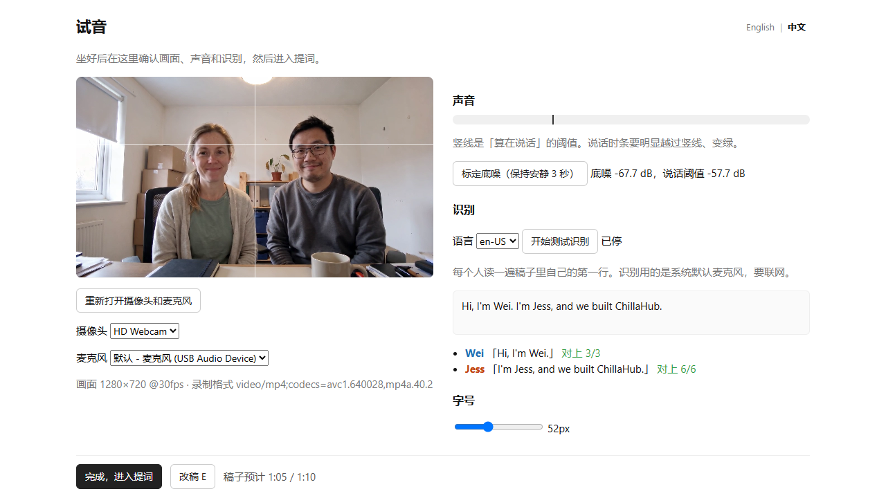
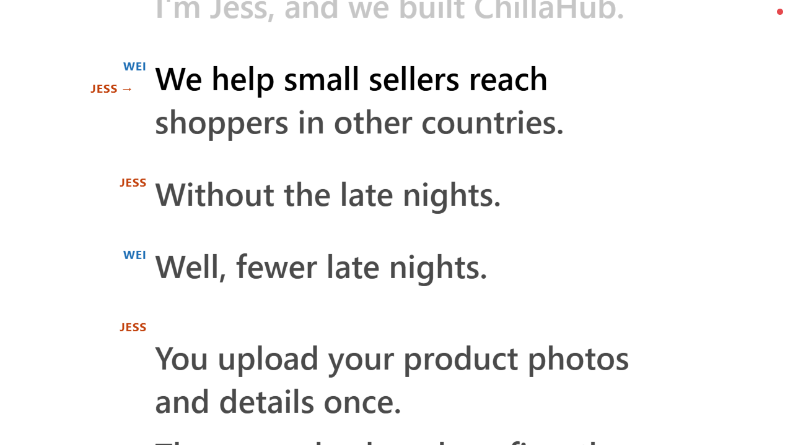
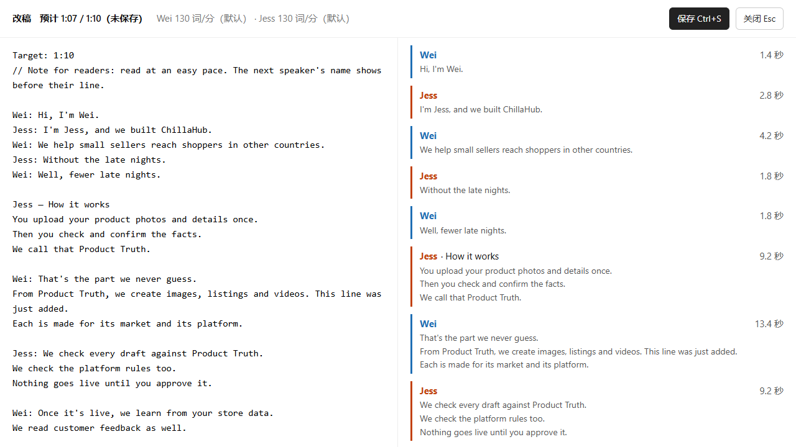

# voice-teleprompter

[English](README.md) · **中文**

一个在 Chrome 里运行的提词器。你念的时候它在听，稿子跟着你的声音往上走。轮到下一个人之前，会先提示他的名字。它同时用摄像头录像。一个人能用，几个人轮流说也能用。

<!-- media:hero -->
https://github.com/user-attachments/assets/ff17caf7-fa1d-441f-b3f3-5d81a3b9e676

手机竖版（9:16）：[中文界面](https://github.com/hengjingzhu/voice-teleprompter/releases/download/v1.0.0/voice-teleprompter-demo-vertical-zh.mp4) · [英文界面](https://github.com/hengjingzhu/voice-teleprompter/releases/download/v1.0.0/voice-teleprompter-demo-vertical-en.mp4)

<sub>演示：画面里的人和声音都是 AI 生成的，名字是虚构的。语音识别是模拟的，方便重新生成演示。用真的麦克风时效果一样。</sub>

## 用 Claude Code 或 Codex 安装

大多数人会把这个仓库交给编程代理。先装好其中一个（[Claude Code](https://code.claude.com/docs/en/quickstart) 或 [Codex](https://learn.chatgpt.com/docs/codex/cli)），在一个新建的空文件夹里打开它，然后粘贴：

```text
把 https://github.com/hengjingzhu/voice-teleprompter 克隆到这个空文件夹
（git clone https://github.com/hengjingzhu/voice-teleprompter .），读一下里面的 AGENTS.md，
按它的 install-and-start 技能做。装任何东西之前先问我。启动提词器并在 Chrome 里打开，
然后告诉我在试音页要做什么。
```

仓库里写好了给代理看的说明：规则在 [`AGENTS.md`](AGENTS.md)，四个技能在 [`.claude/skills/`](.claude/skills)（Claude Code）和 [`.agents/skills/`](.agents/skills)（Codex）。第一次启动后，可以这样说：

| 你说 | 代理会 |
| --- | --- |
| 「把这份稿子换上：……」 | 按格式写进 `script.md`，一个字不改；列出可能的笔误；告诉你大概要念多久。 |
| 「哪一条最好？剪到 1:30。」 | 列出所有录像，剪你选的那条，并确认最后一个词没被切掉。 |
| 「它老是卡在我们的品牌名上。」 | 找出识别把它听成了什么，加进 `aliases.json`。 |

以后的会话都在 `voice-teleprompter` 文件夹里打开，代理才会读到 `AGENTS.md` 和这些技能。

## 自己安装

需要 [Node.js](https://nodejs.org) 22 或更新版本、台式机或笔记本上的 Google Chrome，以及网络（语音识别要联网）。[ffmpeg](https://ffmpeg.org) 可装可不装（见[文件](#文件)）。

```sh
git clone https://github.com/hengjingzhu/voice-teleprompter
cd voice-teleprompter
npm start
```

然后用 Chrome 打开 <http://localhost:5178>，允许摄像头和麦克风。不需要 npm install。换端口：`PORT=5200 npm start`（Windows PowerShell：`$env:PORT=5200; npm start`）。

第一次启动时，会用 [`examples/demo-two-speakers.md`](examples/demo-two-speakers.md) 生成 `script.md`。换成你自己的稿子，或者在页面上按 <kbd>E</kbd> 改稿。

## 录一条

### 1. 试音



<!-- media:setup -->
https://github.com/user-attachments/assets/22b5728a-a134-4ad6-b294-e4ba3ed94c77

- 点 <b>打开摄像头和麦克风</b>。有多个设备时在下拉框里选。预览上的线帮你给两个人构图。
- 点 <b>标定底噪（保持安静 3 秒）</b>。说话时，音量条要明显越过竖线并变绿。
- 点 <b>开始测试识别</b>，每个人念稿子里自己的第一行。这一行有 80% 以上的词被认出来，就会变绿。没写说话人名字的稿子不分人检查，念第一行，看听到的文字就行。
- 调好 <b>字号</b>，选识别语言（en-US、en-AU 或 en-GB），然后点 <b>完成，进入提词</b>。

界面语言的切换（English | 中文）在这一页的右上角。

### 2. 录制



<!-- media:follow -->
https://github.com/user-attachments/assets/9aa9e529-8d1f-40aa-99a6-c91b1916aed6

- 在任意空白处单击（或按 <kbd>空格</kbd>）开始。先倒数 3、2、1，页面进入全屏，倒数结束才开始录。
- 看着屏幕上方那条线念。字会跟着你的声音走。轮到别人之前的最后一段，左边会出现他的名字和箭头，比如 `JESS →`。
- 如果有人在说话，但识别 0.7 秒都没对上新词，字会按这个人平时的语速继续走，最多 3 秒、最多超前 15 个词，然后停下等。
- 字跟丢了，就用滚轮或方向键，一次挪一小段。

### 3. 停止，或者重来

<!-- media:controls -->
https://github.com/user-attachments/assets/9a31138e-2b02-4940-9f90-8b200f561a19

- **停止并保存：** 按住左键 1 秒（或按 <kbd>空格</kbd>）。录制时鼠标指针是隐藏的，按住时右上角会有一个小圈在转满。
- **作废重来：** 按住右键 1 秒（或按 <kbd>X</kbd>）。这一条会保存成名字带 `-x` 的文件，然后马上重新倒数。全屏时 Chrome 会把 <kbd>Esc</kbd> 拿去退出全屏，所以全屏时要用 <kbd>X</kbd>。
- **自动停止**（开录后前 10 秒不会自动停）：
  - 最后一段很短（单独成段，比如 `Both: Thanks for watching!`，最多 3 个实词）：字走到它前一段以后，听到这几个词 2 秒后停。没写说话人名字的稿子只有一段，只适用下面两条；
  - 字走到最后一个词 2 秒后停；
  - 或者字离结尾不到 3 个词，并且 3.5 秒里既没听到人声、也没对上新词，就停。

### 4. 回看


每录完一条并停下（作废的那条会直接重新倒数），会进回看页。上面写着文件名、时长、是怎么停的，下面是带颜色的稿子：<b>红</b> 是没对上的词（多半是识别听错，不是念错；连成一大片的才可能是真念错了），<b>黄</b> 是用滚轮跳过的，<b>灰</b> 是没念到的。按钮有 <b>打开 takes 文件夹</b>、<b>回到试音</b>、<b>回到提词</b>。单击空白处也能回到提词。

## 操作

<!-- shortcuts:start -->

| 鼠标 | 什么时候 | 作用 |
| --- | --- | --- |
| 单击空白处 | 开录前 | 开始录一条（倒数 3 秒） |
| 单击空白处 | 回看页 | 回到提词 |
| 滚轮 | 开录前、录制中 | 后退或前进一小段 |
| 按住左键 1 秒 | 录制中 | 停止并保存这一条 |
| 按住右键 1 秒 | 录制中 | 作废这一条，马上重新倒数 |
| 右键单击 | 倒数时 | 取消倒数 |

| 按键 | 什么时候 | 作用 |
| --- | --- | --- |
| <kbd>空格</kbd> | 开录前、回看页 | 开始录一条（倒数 3 秒） |
| <kbd>空格</kbd> | 录制中 | 停止并保存这一条 |
| <kbd>X</kbd> / <kbd>Esc</kbd> | 录制中 | 作废这一条，马上重新倒数 |
| <kbd>X</kbd> / <kbd>Esc</kbd> | 倒数时 | 取消倒数 |
| <kbd>→</kbd> / <kbd>↓</kbd> / <kbd>Page Down</kbd> | 开录前、录制中 | 前进一小段 |
| <kbd>←</kbd> / <kbd>↑</kbd> / <kbd>Page Up</kbd> | 开录前、录制中 | 后退一小段 |
| <kbd>E</kbd> | 开录前、回看页、试音页 | 打开改稿 |
| <kbd>M</kbd> | 开录前、回看页 | 打开试音 |
| <kbd>+</kbd> / <kbd>=</kbd> | 随时（改稿页除外） | 字号加大 |
| <kbd>-</kbd> / <kbd>_</kbd> | 随时（改稿页除外） | 字号减小 |
| <kbd>F</kbd> | 随时（改稿页除外） | 进入 / 退出全屏 |
| <kbd>Ctrl+S</kbd> | 改稿页 | 保存稿子 |
| <kbd>Esc</kbd> | 改稿页 | 关闭改稿 |

<!-- shortcuts:end -->

## 写稿子

稿子就是 `script.md`，一个纯文本文件。一个短例子：

```text
Target: 1:00
// 以 // 开头的行是写给自己看的备注，不显示、不念。

Wei: Hi, I'm Wei.
Jess: I'm Jess, and we built ChillaHub.
Wei: We help small sellers reach shoppers in other countries.

Jess — How it works
You upload your product photos and details once.

Both: Thanks for watching!
```

- `名字: 文字` 开始一个人的段落，前提是这个名字至少出现两次，或者至少有一次是单独一行的 `名字:` 或 `名字 — 标题`。否则整行算正文（所以 `Upload: …` 还是正文）。只说一行的人，单独写一行 `名字:`，文字放下一行。
- `名字 — 标题` 开始一个带标题的段落（先空格，再加 `-`、`–` 或 `—`）。标题会显示，但不用念，录制时隐藏。
- `Both:`、`All:` 或 `Together:` 是大家一起念。
- 每一行是一段。行首的编号，比如 `1.`，会显示，念不念都可以。
- 第一行写 `Target: 1:30` 就设定了时长上限。稿子超过上限时，页面上的预计时长会变红。不写就不显示上限。
- 稿子必须是英文。

所有规则和例子见 [`examples/format-reference.md`](examples/format-reference.md) 和 [`docs/script-format.md`](docs/script-format.md)（英文）。更多例子：[一个人](examples/solo.md)、[三个人](examples/three-speakers.md)。

### 在页面上改稿



<!-- media:editor -->
https://github.com/user-attachments/assets/d3217a8f-292f-4fd5-aded-ed0fd164ced5

按 <kbd>E</kbd> 打开改稿。右边显示稿子会怎么分成说话人和段落、每段要几秒，预计总时长在顶部。点 <b>保存</b> 写回 `script.md`，旧版本存进 `backups/`。如果你用别的程序改了 `script.md`，页面会自己重新载入（正在录的话，等这条录完再载入）。

预计时长 = 1.5 秒 + 每段的词数按这段说话人的语速算 + 每个 `Both:` 段 1 秒 + 2 秒。语速从你录过的条目里测出来，作废的也算（每个人最近 5 条的中位数，存在 `stats.json`）。还没测过的人，以及没写说话人名字的稿子，一律按每分钟 130 个词算。

## 文件

| 路径 | 是什么 |
| --- | --- |
| `script.md` | 你的稿子。不进 git。 |
| `takes/take-NN-YYYYMMDD-HHMMSS.mp4` | 一条录像。旁边同名的 `.json` 里有识别记录、时间和当时的稿子（`-recovered` 的没有）。 |
| `takes/…-x` | 作废的一条。 |
| `takes/…-partial` | 往本地服务器上传时断了。完整的一份已经存到你的「下载」文件夹。 |
| `takes/…-recovered` | 录到一半被打断的一条（页面、浏览器、服务器或电脑停了）。服务器下次启动时，如果这个半截文件已经 60 秒没人写，就把它救回来；不到 60 秒的先不动，等再下一次启动。 |
| `backups/` | `script.md` 的旧版本，每保存一次存一份。 |
| `stats.json` | 每个人实测的语速。 |
| `aliases.json` | 识别老听错的词，比如 `"chillahub": ["chiller hub"]`。改完要刷新页面。 |

Chrome 一般录成 MP4（H.264）。装了 ffmpeg 的话，服务器会把每条录像整理成标准 MP4，不重新编码画面；WebM 录像会转成 H.264，原文件留成 `.raw.webm`。没装 ffmpeg 就保留浏览器录出来的原文件（`.mp4` 或 `.webm`）。

## 录出来的样子

<!-- media:opening -->
https://github.com/user-attachments/assets/f55872fb-30c1-4156-b495-c11f7a74cb64

<sub>示意：这段是为演示用 AI 生成的，不是这个工具录的。</sub>

## 隐私和限制

- **语音识别用的是 Chrome 自带的。** 它会把麦克风的声音发给 Google，要联网。其他东西都留在你的电脑上：服务器只在 `127.0.0.1` 上监听，稿子和录像都存在这个文件夹里，不会发到别的地方。
- **口音重的地方会跟慢。** 识别成乱码的地方，字会变慢或停住。用滚轮帮一下，把老听错的名字加进 `aliases.json`。
- **只支持英文稿子。** 其他语言的文字会显示，但跟不了。
- **它不知道是谁在说话。** 识别用的是系统默认麦克风（试音页的下拉框选的是录像用的麦克风），轮到谁由稿子的顺序决定。
- **只支持电脑上的 Chrome。** 其他浏览器没有语音识别，或者用的是另一套。

## 测试情况

整个应用（摄像头、麦克风、识别、录像）在 Windows 11 + Chrome 上测过。单元测试每次推送都会在 Windows、macOS 和 Linux 上用 Node 22 跑一遍（见 [Actions](../../actions)）。macOS 和 Linux 上的应用应该能用，但没有人工测过。

## 开发

```sh
npm test                 # 单元测试，包括模拟念完每份示例稿和你自己的 script.md
npm run docs:tables      # 用 public/shortcuts.js 重写两份 README 里的操作表
npm run estimate         # 看 script.md（或你指定的文件）的说话人、词数和预计时长
npm run docs:media       # 重新生成截图和演示视频（需要先 npm install，还要 Chrome 和 ffmpeg，见 docs/demo-media.md）
```

不开麦试一下：在 `script.md` 还是演示稿的时候，打开 <http://localhost:5178/?sim=demo.json>。页面会重放做演示视频时用的模拟识别结果（加上 `&stage=setup` 会从试音页开始）。原理见 [`docs/`](docs/)（英文），参与开发见 [`CONTRIBUTING.md`](CONTRIBUTING.md)。

## 许可证

[MIT](LICENSE)

---

由 [ChillaHub](https://chillahub.ai) 开发。ChillaHub 帮小卖家为每个市场制作并核对商品页、图片和视频。
