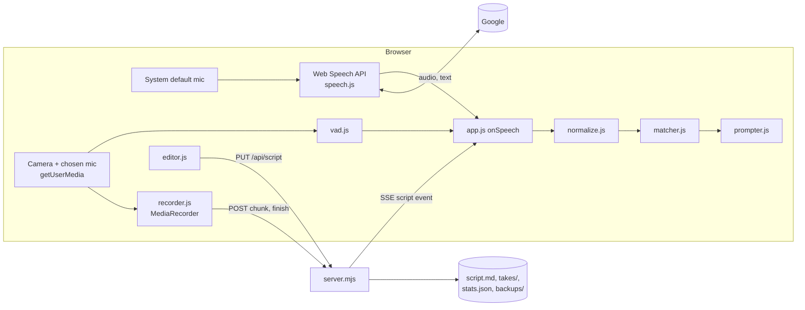
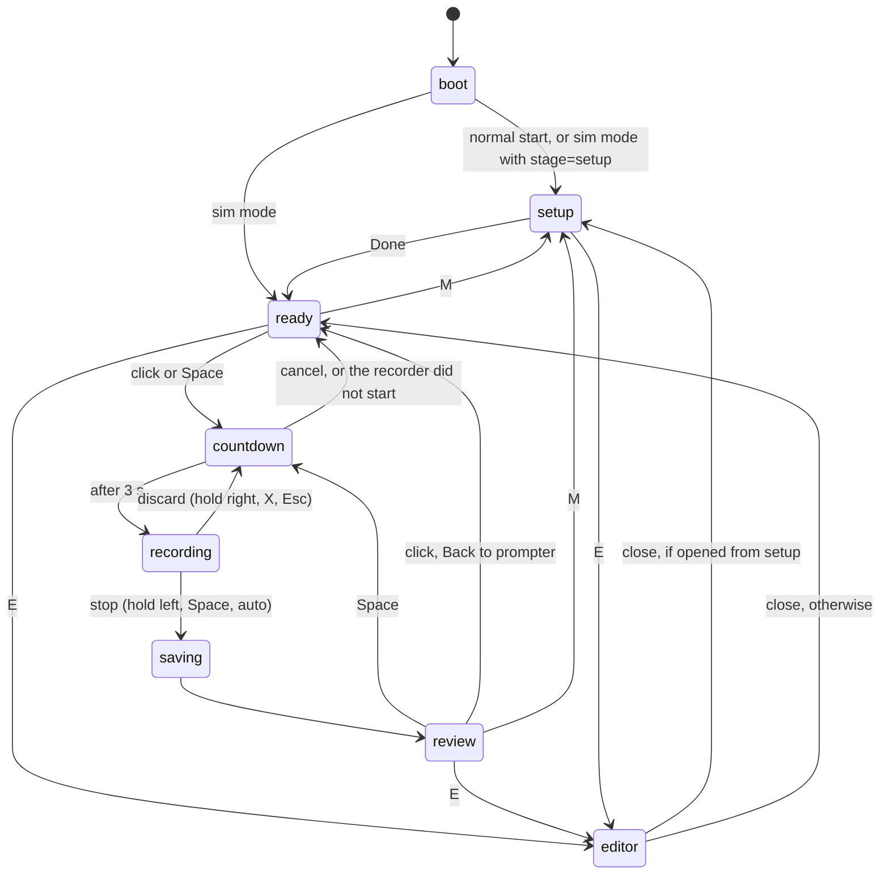

# Architecture

How the pieces fit together. For what the app does from a user's point of view, see the [README](../README.md).

There are two parts:

- **The server**, [`server.mjs`](../server.mjs). Plain Node, no dependencies. It serves the page, reads and writes `script.md`, receives recordings in chunks, converts them with ffmpeg, and keeps reading-speed statistics.
- **The page**, [`public/`](../public). Plain ES modules, no build step, no framework. It runs in desktop Chrome. It does the speech recognition, the alignment, the display and the recording.

## Files

| File | What it does |
| --- | --- |
| `server.mjs` | `createServer()`: static files, the `/api` endpoints, chunked upload, finish, `.part` recovery, script watching. |
| `public/index.html`, `public/styles.css` | The page and its screens. |
| `public/app.js` | The state machine. Wires recognition, matcher, display, recording and input together. Builds the review page. Runs the simulation mode. |
| `public/parse.js` | `parseScript()`: script text → blocks, paragraphs, words, tokens, phrases. See [script-format.md](script-format.md). |
| `public/normalize.js` | `normalizeWords()`, `normalizeText()`, `buildAliasMap()`, `similarity()`. Used for both the script and the recognition text. |
| `public/matcher.js` | `createMatcher()`, `alignTail()`, `endHeard()`. See [matching.md](matching.md). |
| `public/estimate.js` | `estimate()`, `measureWpm()`, `fmtSec()`, `DEFAULT_WPM`. |
| `public/prompter.js` | `Prompter` (rendering and scrolling) and `speakerColors()`. |
| `public/speech.js` | `Speech`: Chrome's Web Speech API with automatic restarts. |
| `public/vad.js` | `Vad`: volume-based "is anyone speaking" detection. |
| `public/recorder.js` | `openStream()`, `pickMime()`, `TakeRecorder` (MediaRecorder and chunk upload). |
| `public/editor.js` | `Editor`: the script editor overlay. |
| `public/i18n.js` | All UI text in English and Chinese, and `t()`, `bind()`, `applyDom()`, `setLang()`. |
| `public/shortcuts.js` | Every mouse and keyboard control, as one table. |
| `scripts/docs-tables.mjs` | Writes the controls tables in the READMEs from `public/shortcuts.js`. |
| `test/simulate.mjs` | Simulated recognition, for the tests and the `?sim=` mode. |

`parse.js`, `normalize.js`, `matcher.js`, `estimate.js`, `i18n.js` and `shortcuts.js` do not need the DOM. The tests import them directly with `node --test`.

## Data flow



1. At boot the page fetches `/aliases.json`, `/api/script` and `/api/stats` in parallel (`public/app.js` `boot()`). It parses the script, builds a matcher and renders the prompter.
2. Recognition results arrive in `onSpeech()`. The last 24 raw words of each result are normalised and the last 8 tokens form the *tail*. `matcher.update()` moves the cursor. Each frame, `frame()` passes the display position to `prompter.update()`.
3. The VAD reads the recording stream. It drives inertia scrolling and the quiet-based auto-stop.
4. MediaRecorder hands a chunk to `TakeRecorder` every second. The chunk goes to the server at once.
5. Saving in the editor sends the script to the server. The server's directory watch sees the change and pushes it to every open page.

## Server

### `createServer(options)`

```js
createServer({ root, port = 5178, host = '127.0.0.1', ffmpeg = 'ffmpeg', log = console.log })
```

- `root`: the folder that holds `public/`, `examples/`, `takes/`, `backups/`, `script.md`, `stats.json` and `aliases.json`. `takes/` and `backups/` are created if missing.
- `port`, `host`: where to listen. Only `127.0.0.1` by default.
- `ffmpeg`: the ffmpeg command. The tests pass a command that does not exist, or `node` itself to get a deterministic failure.
- `log`: where log lines go.

It returns an `http.Server` that is already listening. `server.recovery` is a promise that resolves to one result per left-over `.part` file. `server.close()` also stops the script watch, the SSE pings and the open SSE streams.

Run directly (`node server.mjs`), it uses the `PORT` environment variable or 5178. On `EADDRINUSE` it prints a hint and exits.

### Endpoints

| Method | Path | What it does |
| --- | --- | --- |
| GET | `/`, `/index.html` | `public/index.html`. |
| GET | `/<file>` | A file from `public/`. Paths outside `public/` get 404. |
| GET | `/aliases.json` | The `aliases.json` in the root folder. |
| GET | `/fixtures/<file>` | A file from `test/fixtures/`, for the `?sim=` mode. |
| any | `/favicon.ico` | 204, no body. |
| GET | `/api/script` | The text of `script.md`. Empty when there is none. |
| PUT | `/api/script` | Copies the current `script.md` to `backups/script-YYYYMMDD-HHMMSS.md`, then writes the request body. Answers `{ ok: true }`. |
| GET | `/api/events` | Server-Sent Events. Sends `: hi` at once, an `event: script` with `{ text }` when `script.md` changes, and `: ping` every 25 s. |
| GET | `/api/stats` | `stats.json`, or `{ samples: {}, wpm: {} }` when there is none. |
| POST | `/api/takes` | Picks the next take id, creates an empty `takes/<id>.part`, answers `{ id }`. |
| POST | `/api/takes/open` | Opens `takes/` in the file manager (`explorer`, `open` or `xdg-open`). `{ ok: true }`, or 500 `E_OPEN_FOLDER`. |
| POST | `/api/takes/<id>/chunk?offset=N` | Appends the body to `<id>.part` if it starts at byte N. See [Chunked upload](#chunked-upload). |
| POST | `/api/takes/<id>/finish` | JSON body `{ ext, mime, discarded, uploadFailed, meta }`. Renames and converts the recording, writes the take JSON, updates `stats.json`. Answers `{ file, note, noteDetail, stats }`. |

Errors are JSON `{ error: CODE }`. The page turns a code into text with `codeText()` and the `err.<CODE>` keys in `public/i18n.js`.

| Code | Status | Meaning |
| --- | --- | --- |
| `E_ORIGIN` | 403 | The Host or Origin check failed. |
| `E_BAD_ID` | 400 | The take id does not match `ID_RE` (`take-NN-YYYYMMDD-HHMMSS`). |
| `E_BAD_OFFSET` | 400 | `offset` is missing or not a whole number. |
| `E_OFFSET` | 409 | The chunk does not start where the file ends. The answer includes the server's `size`. |
| `E_GONE` | 410 | The `.part` no longer exists (it was recovered at a restart, or deleted). |
| `E_OPEN_FOLDER` | 500 | The file manager could not be started. |
| `E_NO_FFMPEG`, `E_FFMPEG_FAILED` | 200 | Not errors: `note` values of a finish. The browser's own file was kept. |

Any other exception answers 500 with the exception message.

### The Host and Origin check

`apiAllowed()` runs for every path under `/api`. Static files are served whatever the Host.

- The `Host` header must be `127.0.0.1:<port>`, `localhost:<port>` or `[::1]:<port>`. This blocks DNS rebinding: a page on another domain that resolves to 127.0.0.1 still sends its own domain as Host.
- GET and HEAD pass after the Host check.
- Any other method needs an `Origin` of `http://` plus one of those hosts. Browsers always send `Origin` on a cross-origin POST or PUT, so other web pages cannot overwrite `script.md`, create takes or open folders.
- A write without `Origin` passes only when `Sec-Fetch-Site` is `same-origin` or `none`. A bare `curl -X PUT` is refused; add `-H "Origin: http://localhost:5178"`.

### Chunked upload

The browser sends each chunk with the byte offset where it starts. `appendChunk()`:

- appends when the `.part` size equals `offset`, and answers `{ ok: true, size }`;
- answers 200 with the current size when the size equals `offset + chunk length` (a retry of a chunk that already arrived);
- answers 409 `E_OFFSET` with the size otherwise, and writes nothing;
- answers 410 `E_GONE` when the `.part` is missing.

So the file never has a gap or a repeated chunk. `locked()` runs one operation at a time per take id, so a retried chunk cannot race its first attempt, and finish or recovery cannot race a chunk.

The browser side (`public/recorder.js` `TakeRecorder.sendChunk()`) sends chunks strictly in order. It tries each chunk up to 5 times. Before the retries it waits `RETRY_MS` = 500, 1000, 2000 and 4000 ms. Each request times out after `CHUNK_TIMEOUT_MS` = 20000 ms.

- A network error, a timeout or a 5xx: try again.
- 409: success if the server's `size` equals `offset + chunk size` (an earlier attempt got through). Otherwise give up.
- 410 or another 4xx: give up.

After giving up, `TakeRecorder` sends nothing more for this take. Every chunk is still in memory. At finish the browser downloads the complete recording as `<id>.<ext>`, and the server names its incomplete copy `-partial`.

### Finish

`finishTake()` renames `<id>.part` to `<base>.raw.<ext>`. `base` is the id plus `-x` for a discarded take and `-partial` when the upload broke off. Then `ffmpegPlan()` picks one ffmpeg run:

| Recorded file | ffmpeg arguments after `-i` | Keeps the original |
| --- | --- | --- |
| `.webm` | `-c:v libx264 -preset veryfast -crf 18 -pix_fmt yuv420p -c:a aac -b:a 160k -movflags +faststart` | Yes, as `<base>.raw.webm` |
| `.mp4`, MIME contains `opus` | `-c:v copy -c:a aac -b:a 160k -movflags +faststart` | No |
| other `.mp4` | `-c copy -movflags +faststart` | No |

The plain MP4 remux exists because Chrome records fragmented MP4, and some players miss its duration. If ffmpeg is missing, fails or writes an empty file, the original is renamed to `<base>.<ext>` and the answer carries `note` = `E_NO_FFMPEG`, or `E_FFMPEG_FAILED` with `noteDetail`. If the `.part` is gone, `file` is `null` and `note` is `E_GONE`; the take JSON is still written. Details of the files: [recording-and-files.md](recording-and-files.md).

### `.part` recovery at startup

After the server starts listening, `recoverParts()` looks at every `takes/*.part`, in name order. `recoverPart()`:

1. Skips it when `<base>.json` exists.
2. Skips it when it changed less than `RECOVER_AFTER_MS` = 60 s ago. A take may still be recording: a page that is still open keeps appending to the same `.part` after a server restart.
3. Deletes it when it is empty.
4. Reads the first bytes (`sniffContainer()`): the EBML header `1A 45 DF A3` means WebM, anything else is treated as MP4.
5. Runs `ffmpeg -c copy` into `<base>-recovered.webm` or `<base>-recovered.mp4` (MP4 also gets `-movflags +faststart`). WebM is not re-encoded: a copy takes seconds and needs no encoder.
6. Deletes the `.part` only when the output exists and is not empty. Otherwise the `.part` itself is renamed to the recovered name, so every byte is kept.

Recovery runs after `listen`, so a long ffmpeg run never delays the page. Each file gets one log line. A recovered take has no JSON: the log lived in the browser.

### First start

If `script.md` does not exist and `examples/demo-two-speakers.md` does (`DEMO_SCRIPT`), the server copies it to `script.md` with `COPYFILE_EXCL` and logs `Created script.md from examples/demo-two-speakers.md`. An existing `script.md` is never replaced.

### Script watching

The server watches the root folder with `fs.watch`, not the file. Many editors save by writing a temporary file and renaming it, which breaks a watch on the file. Events for names other than `script.md` are ignored. After 200 ms without further events the server reads the file. If the text differs from the last text it saw, it sends `event: script` with `{ text }` to every SSE client.

A save from the page also comes back through this path. The page ignores it because the text equals what it already shows.

### Speed statistics

`updateStats()` runs on every finish, including discarded takes. For each speaker in `meta.wpm`:

- only values above 40 and below 300 wpm are kept;
- the value, rounded to 0.1, is appended to `samples[speaker]`, keeping the last `KEEP_SAMPLES` = 5;
- `wpm[speaker]` is the median of those samples (the mean of the two middle values for an even count, rounded to 0.1).

How a take's speeds are measured: [matching.md](matching.md#speeds-and-the-estimate).

## The page

### States

`app.js` keeps one state in `S.state` and mirrors it to `<body data-state>`. The CSS and `public/shortcuts.js` key off that name. `STATES` in `shortcuts.js` lists them: `boot`, `setup`, `ready`, `countdown`, `recording`, `saving`, `review`, `editor`.



| State | What is on screen |
| --- | --- |
| `boot` | Nothing yet. The page loads the script, aliases and stats. |
| `setup` | The sound check overlay: mirrored camera preview with framing lines, camera and microphone lists, video size and recording format, level meter with the threshold line, <b>Calibrate noise floor (stay quiet for 3 s)</b>, recognition language (en-US, en-AU, en-GB), <b>Test recognition</b> with a per-speaker check, <b>Text size</b> (36–80 px, step 2), the script estimate, and the English | 中文 switch. |
| `ready` | The prompter, and the hint bar at the bottom: estimate, <b>Click to start</b>, <b>Wheel to preview</b>, <b>Edit script E</b>, <b>Sound check M</b>. |
| `countdown` | 3, 2, 1 at the reading line, one second each. Block titles and the pointer are hidden. |
| `recording` | The prompter, a 10 px red dot in the top right corner, the `Name →` cue, and the hold ring while a mouse button is held. Titles and the pointer stay hidden. |
| `saving` | <b>Saving…</b> while the last chunks upload and the server finishes. |
| `review` | The summary line, the take's script coloured by result, <b>Open takes folder</b>, <b>Back to sound check M</b>, <b>Back to prompter</b>. |
| `editor` | The script editor: text on the left, parsed blocks with seconds on the right, estimate and speeds at the top. |

Notes:

- Starting a take needs an open camera stream, except in the simulation mode. Without one the page goes to `setup` and shows <b>Open the camera and microphone first</b>.
- Discarding saves the take in the background and starts a new countdown at once. It never shows the review.
- A script change that arrives during `countdown`, `recording` or `saving` waits in `S.pendingScript`. It is applied when the review opens, or at the next countdown.
- The review always shows the script the take was recorded with (`S.takeParsed`).

### The prompter

`public/prompter.js` renders one centred column, 15 em wide. The reading line is at 12% of the window height (`readY`), just below a laptop camera. The default text size is 52 px, line height 1.35.

The background stays white on every screen: the screen is the fill light on the face, and the camera's auto exposure should not jump. So highlighting uses only shades of grey: read words light grey, the current line black, unread words dark grey. Speaker names sit to the left of each block in the speaker's colour.

`update(p)` takes the display position in tokens (fractional during inertia scrolling) and finds the line of the first unread word. `tick(dt)` moves the column towards that line with a damped spring (time constant 0.18 s). Scrolling follows lines, not words, so it does not jitter. Word lines are measured from the rendered spans in `layout()`, which runs again on resize and font size changes.

`updateCue()` in `app.js` shows `Name →` during the last paragraph of a block when the next block with words belongs to someone else.

### Recognition

`public/speech.js` uses `window.SpeechRecognition` or `webkitSpeechRecognition`. Chrome sends the audio to Google, so it needs internet. It always uses the system default microphone, not the one picked on the page.

- Settings: `continuous = true`, `interimResults = true`, `maxAlternatives = 3`, `lang` from the page.
- `onresult` joins the top alternative of every result since `base` into one text. For the last result's other alternatives it adds one text each, with the same prefix. `app.js` aligns all of them and keeps the best score.
- Errors: `not-allowed` and `service-not-allowed` stop listening and report `denied`. `network` reports `network`. `audio-capture` reports `no-mic`. During a take, `denied` and `network` show a toast that says to use the wheel.
- Chrome ends continuous sessions by itself (silence, a network blip, a time limit). While the page still wants to listen, `onend` opens a new session and calls `onRestart()`. `app.js` then widens the alignment window for 3 s.
- Backoff: when a session ended less than 1.5 s after it opened (most likely offline), the next start waits 100 ms, then double that each time, up to 2000 ms. A session that lived longer resets the wait to 0.
- If `start()` throws (the previous session has not released the mic), it retries after 300 ms.
- Recognition starts when the countdown starts, so it is warmed up. `markBase()` at the end of the countdown makes it ignore every result already in the session.

### Recording

`openStream()` asks for video at ideal 1920×1080, 30 fps, and mono audio with `echoCancellation: false`, `noiseSuppression: true`, `autoGainControl: true`. Nothing plays through the speakers, so there is no echo to cancel. The stream opens once on the sound check page and stays open: on Windows the camera is exclusive, and reopening it means another warm-up and exposure adjustment. If saved device ids fail, the page clears them and tries the defaults.

`pickMime()` takes the first type `MediaRecorder.isTypeSupported()` accepts:

1. `video/mp4;codecs=avc1.640028,mp4a.40.2`
2. `video/mp4;codecs=avc1,mp4a.40.2`
3. `video/mp4;codecs=avc1.42E01E,mp4a.40.2`
4. `video/mp4;codecs=avc1,opus`
5. `video/mp4`
6. `video/webm;codecs=vp9,opus`
7. `video/webm;codecs=vp8,opus`
8. `video/webm`

The recorder uses `videoBitsPerSecond: 8_000_000` and `audioBitsPerSecond: 160_000`, and `start(1000)`: a chunk every second. The file extension is `mp4` when the type contains `mp4`, else `webm`. The whole flow is in [recording-and-files.md](recording-and-files.md).

### Voice activity (VAD)

`public/vad.js` connects the recording stream to an `AnalyserNode` (`fftSize` 1024). Each animation frame it computes the RMS level of 1024 samples in dB.

- Threshold = noise floor + 10 dB. The floor defaults to −55 dB.
- Above the threshold for 200 ms: speaking starts. Below it for 350 ms: speaking stops.
- `quietFor(now)`: ms since speaking stopped, 0 while speaking.
- `calibrate(3000)`: samples the level every 50 ms for 3 s; the median becomes the floor (rounded to 0.1 dB). The page saves it.

The level meter on the sound check page shows −80 to 0 dB. The VAD uses the chosen microphone; recognition uses the system default.

### Settings in localStorage

| Key | Contents |
| --- | --- |
| `tp.settings` | `{ fontSize, lang, noiseFloor, camId, micId, uiLang }`. Defaults: `fontSize` 52, `lang` `en-US`, `noiseFloor` −55, empty device ids, `uiLang` `en`. |
| `tp.draft` | `{ text, at }`: unsaved editor text and when it was written. |

Every access is wrapped in `try`, so a private window still works; settings then last until the page reloads. The editor writes the draft on every change while the text differs from the saved script, and removes it on save, on close, or, when the editor opens, if it equals the script. On the next open it offers <b>Restore draft</b> or <b>Discard draft</b>. With unsaved edits, closing or reloading the tab asks first.

### Interface text (`public/i18n.js`)

- `STRINGS.en` and `STRINGS.zh` hold every string the page shows. English is the default. `uiLang` in `tp.settings` keeps the choice.
- `t(key, vars)` returns the text in the current language and fills `{name}` placeholders. A var can be `{ key, vars }` to translate it too. A missing key comes back as the key itself. `tl(lang, key, vars)` does the same for a given language.
- `applyDom()` fills elements with `data-i18n` (text), `data-i18n-title` and `data-i18n-placeholder`.
- `bind(el, key, vars)` sets the text and stores the key and vars on the element, so `applyDom()` re-translates it on a switch. `unbind(el, text)` shows untranslated text.
- `setLang(lang)` saves, sets `<html lang>` (`en` or `zh-CN`), runs `applyDom()` and fires `langchange` on `document`. `app.js` then rebuilds the text it composes itself (estimate, review summary, recognition check, editor banner).
- `codeText(code, detail)` turns a server code into text.

`test/docs.test.mjs` checks that both tables have the same keys and placeholders, that every key the page uses exists, that every server code has a text, and that `server.mjs`, `public/*.js` other than `i18n.js`, and `index.html` (except the 中文 button) contain no CJK text.

### Controls (`public/shortcuts.js`)

`SHORTCUTS` has one entry per control: `id`, `states`, `key` or `mouse`, and optionally `hold` (ms), `press`, `mod: 'ctrl'`, `inFields`, `prevent`, plus `action` (a name in `app.js` `ACTIONS`) and `labelKey` (an i18n key).

- `app.js` does not test keys or buttons itself. Its handlers call `matchKey()`, `matchPointerDown()`, `matchClick()` and `matchWheel()`, then run `ACTIONS[entry.action]`.
- A left-button entry without `hold` or `press` is a click on empty space (not on a button, link, label or field), fired on release.
- A hold starts on pointer down; `drawHold()` fills the ring each frame and runs the action after `hold` ms. Releasing cancels it. On a screen with holds, other buttons do nothing.
- The wheel adds up `deltaY` (line mode × 40). One step fires at 50 (`WHEEL_STEP`), at most once per 90 ms (`WHEEL_COOLDOWN`).
- `BLOCKED_KEYS`: Space, arrows and Page Up/Down never scroll the page outside the editor (unless typing in a field). `BLOCKED_MENU`: the right-click menu is blocked except on the sound check page and in the editor.
- `describeShortcuts(lang)` turns the table into display rows. `npm run docs:tables` (`scripts/docs-tables.mjs`) writes them between `<!-- shortcuts:start -->` and `<!-- shortcuts:end -->` in `README.md` and `README.zh-CN.md`. `test/docs.test.mjs` fails when a README's tables differ from what the script would write.

`test/shortcuts.test.mjs` pins every key, button and state to the behaviour the handlers had before the table existed.

### Simulation mode

`?sim=<file>` loads `/fixtures/<file>` (from `test/fixtures/`). No microphone, no recognition, no recording, no full screen. When a take starts, `runSim()` feeds the fixture's recognition events on their timestamps; `restart` events act like recognition restarts. The fixture's `speech` intervals stand in for the VAD. Stopping shows the review with <b>Simulation, not saved</b>.

`&stage=setup` starts on the sound check page. <b>Test recognition</b> then plays the fixture's `setup.events`, and the camera opens if permission was given before.

Make a fixture from any script with `npm run fixture -- <script.md> <name.json>` ([`test/make-fixture.mjs`](../test/make-fixture.mjs)). It writes to `test/fixtures/`.
