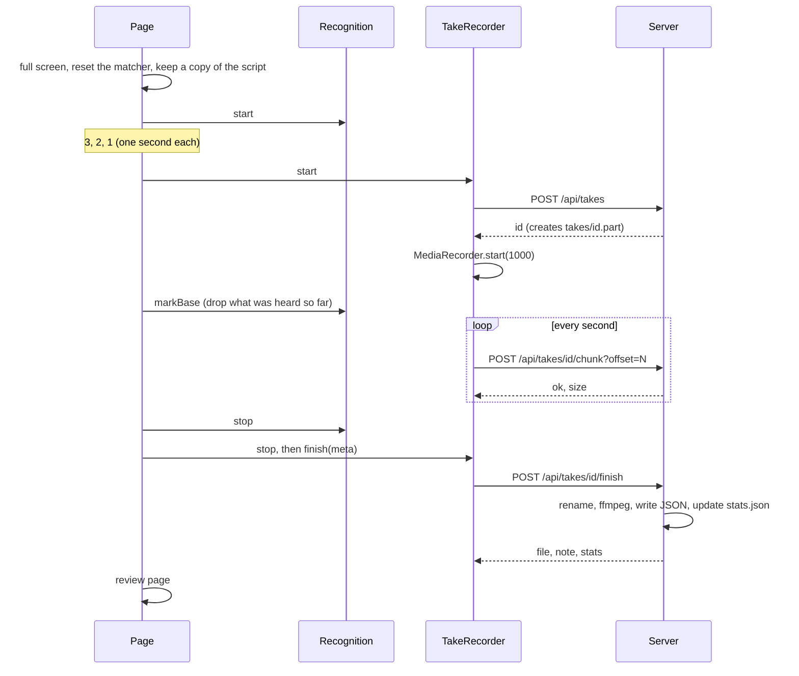

# Recording and files

What happens to a take from the countdown to the file on disk, and every file the app writes. The server side is in [`server.mjs`](../server.mjs) (`finishTake()`, `recoverPart()`), the page side in [`public/app.js`](../public/app.js) (`startCountdown()`, `stopTake()`, `buildMeta()`) and [`public/recorder.js`](../public/recorder.js) (`TakeRecorder`).

## From countdown to file



1. **Start.** A click on empty space or <kbd>Space</kbd> calls `startCountdown()`. Without an open camera it goes to the sound check page instead. A script change that waited during the last take is applied now.
2. **Countdown.** The page requests full screen, resets the matcher, and keeps a copy of the parsed script and its text for this take. Recognition starts now so it is warmed up. 3, 2, 1 are shown for one second each. A right click, <kbd>X</kbd> or <kbd>Esc</kbd> cancels.
3. **Recording starts.** `TakeRecorder.start()` asks the server for a take id (`POST /api/takes`); the server creates an empty `takes/<id>.part`. MediaRecorder starts with a 1 s timeslice. If any of this fails, the page shows <b>Recording did not start: {msg}</b> and goes back. Then `markBase()` makes recognition ignore everything heard during the countdown. The take's clock (`t0`) and `startedAt` are set here, so the countdown is in neither the file nor the log.
4. **Upload.** Every second MediaRecorder hands over a chunk. It is kept in memory and sent at once with its byte offset. Chunks go strictly in order, each retried with backoff ([architecture.md](architecture.md#chunked-upload)). If a chunk still fails, uploading stops for this take; the rest stays in memory only.
5. **Stop.** Holding the left button 1 s, <kbd>Space</kbd>, or an automatic stop calls `stopTake()`. Recognition stops, `buildMeta()` builds the log, and `TakeRecorder.stop()` waits for the last chunk and for every upload to finish.
6. **Finish.** If the upload broke off, the browser first downloads the complete recording from memory as `<id>.mp4` or `<id>.webm` (usually into Downloads). Then it posts `{ ext, mime, discarded, uploadFailed, meta }` to `/api/takes/<id>/finish`. The server renames and converts the file, writes the JSON and updates `stats.json`.
7. **Review.** The page shows the result. A discarded take skips this: it is saved in the background and a new countdown starts at once.

All chunks stay in memory until the finish succeeds: at 8 Mbps that is about 1 MB per second of recording.

## Conversion

The server renames `<id>.part` to `<base>.raw.<ext>` and runs one ffmpeg command (`ffmpegPlan()`). All start with `-y -hide_banner -loglevel error -i <raw>` and end with `-movflags +faststart <base>.mp4`.

| Recorded as | ffmpeg | Result |
| --- | --- | --- |
| MP4 whose MIME type does not contain `opus` (types 1–3 and 5 of the [list](architecture.md#recording)) | `-c copy` | `<base>.mp4`, remuxed without re-encoding. The raw file is deleted. |
| MP4 whose MIME type contains `opus` (type 4) | `-c:v copy -c:a aac -b:a 160k` | `<base>.mp4`, video copied, audio converted. The raw file is deleted. |
| WebM | `-c:v libx264 -preset veryfast -crf 18 -pix_fmt yuv420p -c:a aac -b:a 160k` | `<base>.mp4`, re-encoded. The original is kept as `<base>.raw.webm`. |
| any, but ffmpeg is missing, fails or writes an empty file | — | The browser's file, renamed `<base>.mp4` or `<base>.webm`. The review shows why. |

The plain remux matters: Chrome records fragmented MP4, and some players miss its duration.

## File names

A take id is `take-NN-YYYYMMDD-HHMMSS`:

- `NN` is one more than the highest take number in `takes/`, with at least two digits. The server also remembers the last number it gave out, so deleting files does not reuse numbers while it runs.
- `YYYYMMDD-HHMMSS` is the server's local time when the id was created: the end of the countdown.

The file name base adds suffixes in this order:

| Suffix | Meaning |
| --- | --- |
| `-x` | Discarded (held the right button, <kbd>X</kbd> or <kbd>Esc</kbd>). The file is still saved. |
| `-partial` | The upload broke off. The server's file holds only the start. The complete copy is the browser download `<id>.<ext>`. |

So a discarded take whose upload broke off is `take-07-20260101-093000-x-partial.mp4`.

| File | When |
| --- | --- |
| `takes/<id>.part` | While recording. If one is still growing, a take is being recorded. |
| `takes/<base>.mp4` | The finished recording. |
| `takes/<base>.raw.webm` | The browser's WebM original, next to its converted `.mp4`. |
| `takes/<base>.webm` | A WebM kept as recorded, because ffmpeg was missing or failed. |
| `takes/<base>.json` | The take log, below. Written even when the server no longer had the video (`file` is then `null`). |
| `takes/<id>-recovered.mp4`, `takes/<id>-recovered.webm` | A `.part` left behind by a crash, rescued at a later server start ([architecture.md](architecture.md#part-recovery-at-startup)). It has no JSON and may end abruptly. |

## The take JSON

`<base>.json` holds the page's `buildMeta()` result plus three fields from `finishTake()`. It is written with a one-space indent.

| Field | From | Meaning |
| --- | --- | --- |
| `startedAt` | page | ISO time when recording started (the end of the countdown). |
| `durationMs` | page | Milliseconds from the start of recording to the stop. An automatic stop includes the wait before it. |
| `endedBy` | page | `auto`, `manual` or `discard`. |
| `lang` | page | Recognition language: `en-US`, `en-AU` or `en-GB`. |
| `scriptHash` | page | FNV-1a hash of the script text, 8 hex digits. |
| `scriptSnapshot` | page | The full script text used for the take. |
| `cursor` | page | Tokens passed when the take stopped. |
| `tokenCount` | page | Tokens in the script. `cursor` equals it when the end was reached. |
| `missed` | page | Indices of tokens passed without a match. Optional numbers and wheel skips are not included. Red on the review page. |
| `missedWords` | page | The normalised text of each missed token, e.g. `chillahub`, `3000000`. |
| `manual` | page | Indices of tokens skipped forward with the wheel or keys. Yellow on the review page. |
| `tokenTimes` | page | Per token: ms from the start of recording when the cursor passed it, or `null` (not reached, or skipped by hand). Recognition reports words late, so these are later than the speech. |
| `recognitionRestarts` | page | How many times recognition reopened its session, the countdown included. |
| `transcriptEvents` | page | Every recognition event: `t` (ms from the start of recording), `text` (only the latest result segment), `tail` (the tokens used for alignment, space-separated), `final`. |
| `wpm` | page | Each speaker's speed measured in this take ([matching.md](matching.md#speeds-and-the-estimate)). |
| `file` | server | The video file name in `takes/`, or `null`. |
| `mime` | server | The MIME type the page asked MediaRecorder for; empty when it used the browser's default. |
| `uploadFailed` | server | `true` when the upload broke off. Absent otherwise. |

The file holds the whole script and everything the recognizer heard. Treat it as private.

## `stats.json`

```json
{
  "samples": { "Alex": [128.4, 131, 125.9], "Sam": [142.2] },
  "wpm": { "Alex": 128.4, "Sam": 142.2 }
}
```

Every finish adds the take's `wpm` values, discarded takes included. Only values above 40 and below 300 are kept. `samples` holds each speaker's last 5; `wpm` is their median. The estimate uses `wpm` and falls back to 130. Speakers are keyed by their exact name in the script. Delete the file to start over.

## `backups/`

Each <b>Save</b> in the editor sends the script to `PUT /api/script`. Before writing, the server copies the current `script.md` to `backups/script-YYYYMMDD-HHMMSS.md` (local time). Nothing in `backups/` is ever deleted. Changes made to `script.md` outside the page are not backed up by the server.

## `aliases.json`

Words the recognizer keeps writing differently:

```json
{
  "chillahub": ["chiller hub", "chilla hub", "killer hub"],
  "thanks": ["thank you", "thank"]
}
```

- The key is what the token becomes; the list holds what the recognizer writes. Both are normalised (lower case, no punctuation), and a variant can be several words.
- The script and the recognition text both pass through it. A variant in the script becomes the key too.
- Keys count as names when matching (weight 1.5).
- Never add a common English word as a variant: it would be replaced everywhere, in the script and in what is heard, and the prompter would jump.
- The page reads the file once, when it loads. Reload the page after editing it, after the current take.
- The tests load the same file. Run `npm test` after editing it.

The `fix-mishearings` agent skill finds candidates from `missedWords` and `transcriptEvents` across takes.

## Trimming a take

The take starts at the end of the countdown, so only the end usually needs cutting. ffmpeg and ffprobe are needed. The same steps are in the `pick-and-trim` agent skill ([`.agents/skills/pick-and-trim/SKILL.md`](../.agents/skills/pick-and-trim/SKILL.md)).

Pick the file first. For `-partial` takes use the complete copy in Downloads. `-recovered` takes may end abruptly. `-x` takes were discarded.

1. Find where the speech really ends. Look at the last 8 seconds:

   ```sh
   ffmpeg -hide_banner -ss <END_MINUS_8> -i <TAKE> -af silencedetect=noise=-45dB:d=0.15 -vn -f null -
   ```

   Add the `-ss` value to the last `silence_start`: that is where the last word ends. Do not use the times in the take JSON: recognition reports words later than they were spoken.

2. Cut from the start without re-encoding, keeping at least 0.25 s after the last word:

   ```sh
   ffmpeg -i <TAKE> -t <SECONDS> -c copy -movflags +faststart takes/<NAME>-final.mp4
   ```

3. Check the result. Read its duration with `ffprobe`. Look at a frame from the last 0.3 s to make sure it is not black or frozen:

   ```sh
   ffmpeg -sseof -0.3 -i takes/<NAME>-final.mp4 -frames:v 1 last.jpg
   ```

If the time limit is shorter than the speech, cutting will lose words. Cut earlier in the script, read faster, or record again.
